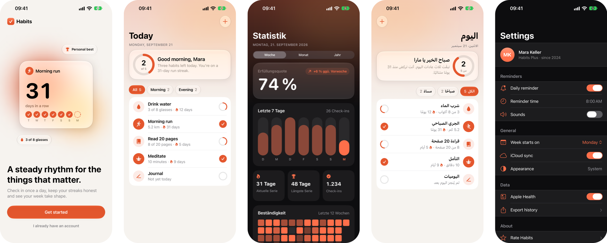
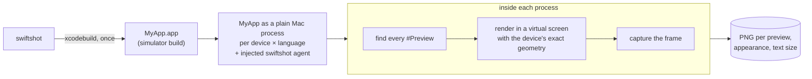

<h1 align="center">Swiftshot</h1>

<p align="center">
  App Store screenshots straight from your SwiftUI and UIKit <code>#Preview</code>s, without booting a simulator.
</p>

<p align="center">
  <a href="https://github.com/LukasAnda/swiftshot/actions/workflows/tests.yml"></a>
  <a href="https://github.com/LukasAnda/swiftshot/releases/latest"></a>
  <a href="https://github.com/marketplace/actions/swiftshot-preview-screenshots"></a>
  
  
  <a href="LICENSE"></a>
</p>

<p align="center">
  <a href="#install">Install</a> ·
  <a href="#quick-start">Quick start</a> ·
  <a href="#device-frames">Device frames</a> ·
  <a href="#ci">CI</a> ·
  <a href="#swiftshot-vs-fastlane">vs fastlane</a> ·
  <a href="https://github.com/LukasAnda/swiftshot/wiki">Documentation</a>
</p>

<p align="center">
  
</p>

- Renders `#Preview`s directly. No UI tests, no `SnapshotHelper.swift`, no simulator to boot.
- Every device, iOS version, language, appearance and text size from one command.
- Pixel identical to a booted simulator's framebuffer, status bar included.
- iPhone, iPad, iPhone Duo and Apple Watch.
- Output in the fastlane/deliver layout, so `fastlane deliver` uploads it unchanged.
- Optional device frames from Apple's bezels, plain or App Store-ready with localized titles.

## Install

Requires an Apple silicon Mac with Xcode 26.6 or 27.x.

```
curl -fsSL https://raw.githubusercontent.com/LukasAnda/swiftshot/main/install.sh | sh
export PATH="$HOME/.swiftshot/bin:$PATH"
```

This installs the latest release into `~/.swiftshot/bin` (set `SWIFTSHOT_PREFIX` to change it).
To build from source instead: `git clone https://github.com/LukasAnda/swiftshot && cd swiftshot && make install`.

## Quick start

Run `swiftshot init` in your project to generate `swiftshot.json`. It detects the project or
workspace, the app scheme (and a watchOS app scheme), the languages from the project's known
regions, and App Store devices installed on this Mac (the newest Pro Max iPhone, the 13-inch iPad
if the app runs on iPad, an Apple Watch Ultra for a watch app). Then run `swiftshot`.

Or pass everything on the command line:

```
swiftshot --project MyApp.xcodeproj --scheme MyApp \
  --devices "iPhone 17 Pro Max,iPad Pro 13-inch (M5)" \
  --languages "en-US,de-DE" --appearances light,dark
```

This builds the app once, finds every `#Preview` and renders each one for every combination of
device, language and appearance. You get:

- `screenshots/<language>/<device>-<preview>.png`
- `screenshots/screenshots.html`, a gallery to review them
- `screenshots/swiftshot-report.json`, a machine-readable report

`swiftshot list --project MyApp.xcodeproj --scheme MyApp` prints the previews it found.
`swiftshot devices` lists the installed runtimes and devices.

Build with the Debug configuration (the default). The compiler only includes `#Preview` code in
Debug builds.

## CI

Swiftshot needs a Mac with Xcode and the runtimes you render. No simulators and no GUI session.
It runs on the free GitHub-hosted `macos-26` and `xcode-27` runners.

GitHub Actions:

```yaml
jobs:
  screenshots:
    runs-on: xcode-27
    steps:
      - uses: actions/checkout@v4
      - uses: LukasAnda/swiftshot@v0.1.3
        with:
          version: 0.1.3      # or "latest"
          # args: --devices "iPhone 17 Pro Max" --languages en-US,de-DE
      - uses: actions/upload-artifact@v4
        with:
          name: screenshots
          path: fastlane/screenshots
```

The action installs the release and runs `swiftshot run` with your `swiftshot.json`, or with `args`.
Use `working-directory` if the project is not at the repo root.

Other CI:

```
curl -fsSL https://raw.githubusercontent.com/LukasAnda/swiftshot/main/install.sh | SWIFTSHOT_VERSION=0.1.3 sh
~/.swiftshot/bin/swiftshot run --download-missing-runtimes
```

The release archive is `swiftshot-macos-arm64.tar.gz` on the
[releases page](https://github.com/LukasAnda/swiftshot/releases); the installer checks its SHA-256.
The exit code is non-zero if any screenshot failed.

### Visual review tools

The output is plain PNGs with stable names, so screenshot review services can take it as is:

```
npx @argos-ci/cli upload fastlane/screenshots   # Argos, needs ARGOS_TOKEN
npx @percy/cli upload fastlane/screenshots      # Percy, needs PERCY_TOKEN
```

## Configuration

Put a `swiftshot.json` next to your project. Keys follow fastlane's `Snapfile`, and every key is
also a flag (see `swiftshot run --help`).

```json
{
  "project": "MyApp.xcodeproj",
  "scheme": "MyApp",
  "devices": ["iPhone 17 Pro Max", "iPad Pro 13-inch (M5)"],
  "ios_versions": ["27.0"],
  "languages": ["en-US", "de-DE", "ja"],
  "appearances": ["light", "dark"],
  "output_directory": "fastlane/screenshots",
  "clear_previous_screenshots": true
}
```

Then just run `swiftshot`.

### Per-screenshot settings

Override settings for previews that match a name or `*` glob. The first match wins.

```
swiftshot --screen "Welcome: appearances=light,dark" \
          --screen "Stats: languages=de-DE,ja devices=iPad*" \
          --screen "Debug*: skip=true"
```

Or in `swiftshot.json`:

```json
"screens": [
  { "preview": "Welcome", "appearances": ["light", "dark"] },
  { "preview": "History", "full_length": true },
  { "preview": "Debug*", "skip": true }
]
```

Keys: `appearances`, `languages`, `devices`, `ios_versions` (`ios` on the command line),
`text_sizes`, `full_length`, `delay`, `skip`.

### Features

- **UIKit.** Preview bodies can be SwiftUI views, `UIViewController`s or `UIView`s.
- **Partial views.** `.sizeThatFitsLayout` and `.fixedLayout(width:height:)` previews render at
  their own size, like in Xcode:
  `#Preview("Habit row", traits: .sizeThatFitsLayout) { HabitRow(habit: .sample) }`
- **Full-length.** `--full-length` grows a screen until its scroll view shows all of its content.
  iOS only.
- **Sheets and alerts.** Present them in the preview and they are captured fully presented:
  `HabitListView().sheet(isPresented: .constant(true)) { NewHabitView() }`
- **Text sizes.** `--text-sizes default,XXXL,AX5`. Non-default sizes get a `-<size>` file suffix.
- **Status bar.** Full-screen shots show 9:41, full signal and a charged battery.
  `--no-status-bar` leaves it out.
- **Apple Watch.** Add watch models to `--devices`; use `--watch-scheme` if the watch app has its
  own scheme.
- **Slow content.** `--delay <seconds>` waits before each capture, e.g. for async images.

## Device frames

Swiftshot can put screenshots into Apple's official device bezels.

```
swiftshot --frame                 # the device with the screenshot in it, transparent
swiftshot --frame appstore        # App Store size, background and localized title
swiftshot frame fastlane/screenshots --frame appstore   # an existing folder, like frameit
```

- **Plain** frames go to `screenshots-framed/<language>/<name>_framed.png`, for your website or
  press kit.
- **App Store** frames go next to the originals as `<name>_framed.png`, at the exact size App
  Store Connect accepts for the device. `fastlane deliver` uploads them instead of the originals.
- Titles come from `title.strings` in each language folder, or from a frameit `Framefile.json`.
- `--frame-color "Deep Blue"` picks the device colour. Each model has a default.
- iPhone 16 to 18, iPhone Air and Duo, current iPads and Apple Watch Ultra and Series 10/11.
  Other devices stay unframed, with a warning.

The bezels are downloaded from Apple on first use and cached. Swiftshot does not ship them: they
come under Apple's Design Resources License, which you accept once (`--accept-bezel-license` on CI).
The [Device frames](https://github.com/LukasAnda/swiftshot/wiki/Device-frames) wiki page has the
full reference.

## Swiftshot vs fastlane

Measured with this repo's `Example/DemoApp` on the free GitHub-hosted `xcode-27` runner, from a
cold start. The workflow is `.github/workflows/benchmark.yml`, so anyone can re-run it.

Both render the same 5 screens on 3 devices (iPhone 17 Pro Max, iPhone SE, iPad Pro 13-inch) in
3 languages (en-US, de-DE, ar): 45 screenshots each.

| tool | wall clock | per screenshot |
|---|---:|---:|
| `fastlane snapshot` | 4615 s (77 min) | 103 s |
| swiftshot, cold | 84 s | 1.9 s |
| swiftshot, warm build | 55 s | 1.2 s |

Cold includes building the app from an empty DerivedData.

fastlane boots a simulator per device and runs a UI-test session per device and language, which
installs a test runner, relaunches the app and taps to each screen. Swiftshot boots nothing and
navigates nothing: it renders the previews directly. After a single build it starts one short-lived
app process per device and language, in parallel, and each renders all of its previews.

## How it works



1. Swiftshot builds the app once for the iOS simulator.
2. It runs the app directly on the Mac against the simulator runtime, with a small injected
   library. No simulator is booted. A helper provides the Metal, IOSurface and shader compiler
   services a booted simulator would.
3. The library finds every `#Preview` in the built app.
4. It answers UIKit's questions about the screen with the target device's measured geometry:
   size, scale, corner radii, safe areas, Dynamic Island.
5. The app's windows go to a Core Animation render server inside the same process, on a virtual
   display. Its frame is the screenshot. Render settings that depend on timing are pinned, so the
   output never depends on how fast the machine is.
6. The status bar is drawn by the system's own status bar component.

`--mode device` renders in real booted simulators instead and serves as the reference. Output is
verified pixel identical against booted simulators in CI. The
[How it works](https://github.com/LukasAnda/swiftshot/wiki/How-it-works) wiki page has the full
explanation and diagrams.

## Requirements

- Apple silicon Mac
- Xcode 26.6 or 27.x with the simulator runtimes you want to render (Xcode > Settings > Components)
- An app target with `#Preview`s (iOS 17+). Nothing has to be added to your project.

## Development

```
make                                                   # builds bin/
swift test                                             # unit tests
SWIFTSHOT_INTEGRATION=1 swift test --filter IntegrationTests
```

The integration tests render `Example/DemoApp` and compare the output pixel by pixel with booted
simulators.

## Roadmap

| version | |
|---|---|
| [v0.3.0](https://github.com/LukasAnda/swiftshot/milestone/1) | Homebrew: `brew install swiftshot` |
| [v0.4.0](https://github.com/LukasAnda/swiftshot/milestone/2) | Android: Jetpack Compose previews |
| [v0.5.0](https://github.com/LukasAnda/swiftshot/milestone/3) | Compose Multiplatform |
| [v0.6.0](https://github.com/LukasAnda/swiftshot/milestone/4) | Flutter |
| [v0.7.0](https://github.com/LukasAnda/swiftshot/milestone/5) | IDE plugins for Xcode, Android Studio and IntelliJ IDEA |

Version numbers are targets and can move. Details on the
[Roadmap](https://github.com/LukasAnda/swiftshot/wiki/Roadmap) wiki page; suggestions are welcome as
[feature requests](https://github.com/LukasAnda/swiftshot/issues/new?template=feature_request.yml).

## Documentation

The [wiki](https://github.com/LukasAnda/swiftshot/wiki) has the full configuration reference, CI
recipes, a fastlane migration guide and troubleshooting.

## Contributing

Bug reports and pull requests are welcome. See [CONTRIBUTING.md](CONTRIBUTING.md).

## License

AGPL-3.0 — see [LICENSE](LICENSE).
