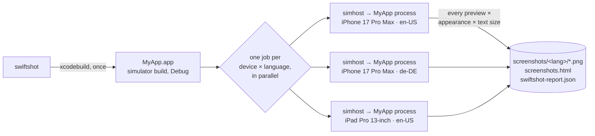
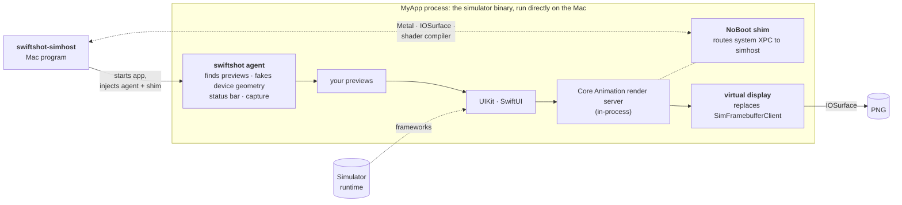
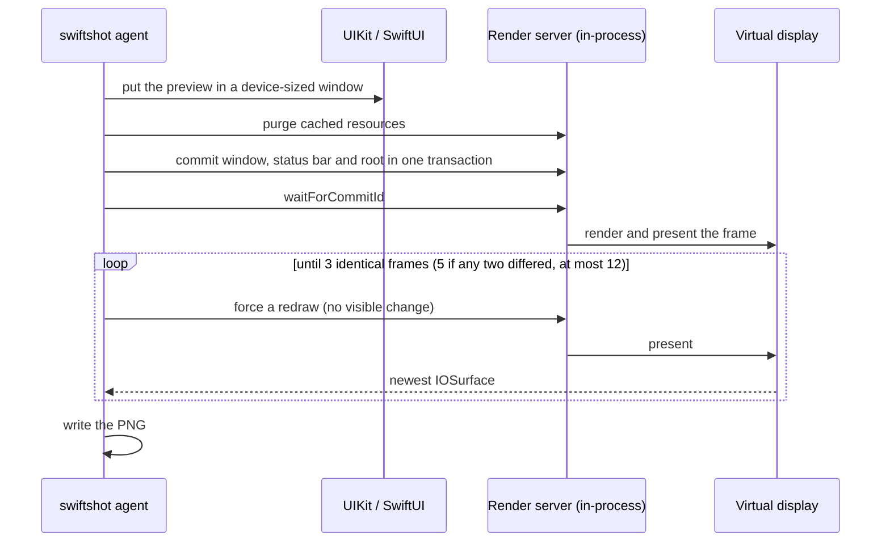
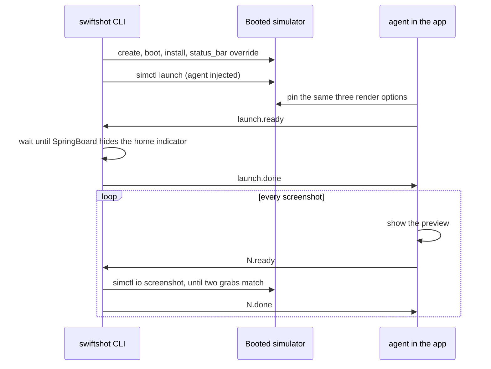
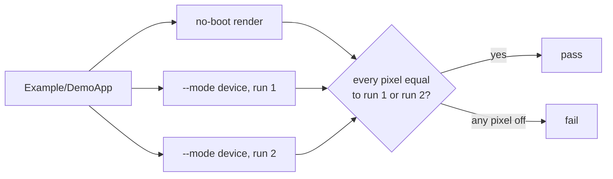
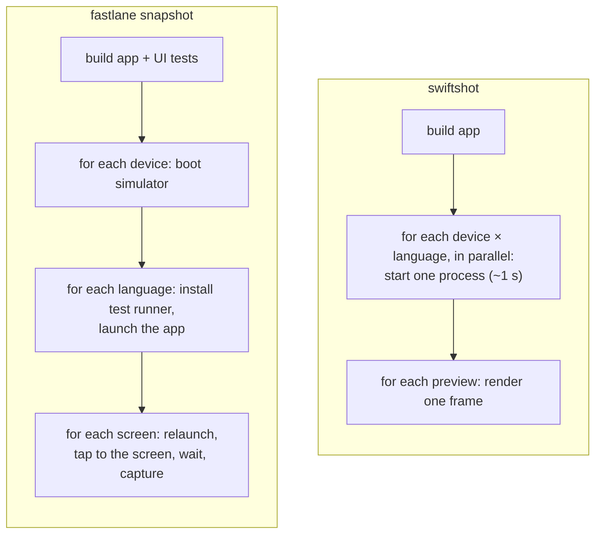

Swiftshot runs your simulator app as a plain Mac process, gives it a virtual screen with the target
device's exact geometry, and lets Core Animation render each preview into it. No simulator is
created or booted. This page explains each step and how the output is kept identical to a booted
simulator.

- [Overview](#overview)
- [1. Build once](#1-build-once)
- [2. Launch without a simulator](#2-launch-without-a-simulator)
- [3. Find the previews](#3-find-the-previews)
- [4. Pretend to be the device](#4-pretend-to-be-the-device)
- [5. Render and capture](#5-render-and-capture)
- [6. Status bar](#6-status-bar)
- [7. Previews, sheets and options](#7-previews-sheets-and-options)
- [8. Apple Watch](#8-apple-watch)
- [9. Device mode, the reference](#9-device-mode-the-reference)
- [10. Proving it's pixel identical](#10-proving-its-pixel-identical)
- [11. Device table](#11-device-table)
- [Why it's faster than fastlane](#why-its-faster-than-fastlane)

## Overview

The jobs run in parallel, up to half the Mac's cores. A job starts in about a second and then
renders each screenshot in well under a second.

## 1. Build once

Swiftshot runs one `xcodebuild build` for the iOS simulator (`arm64`, no code signing) and reads
the `.app` path from the build settings. The same build serves every device, iOS version and
language. It must be a Debug build, because the compiler only includes `#Preview` code in Debug.
`--app` skips the build and uses a prebuilt `.app`.

## 2. Launch without a simulator

A simulator app is an ordinary arm64 Mac binary linked against the simulator runtime's
frameworks. It runs as a normal process once it gets what `launchd_sim` in a booted simulator
would give it, plus the services a booted device provides.

**Environment.** The CLI sets what a booted device's launchd would: `SIMULATOR_ROOT` and
`IPHONE_SIMULATOR_ROOT` pointing at the runtime's `RuntimeRoot`, a fresh `HOME` and `TMPDIR` per
job, and the device variables (`SIMULATOR_MODEL_IDENTIFIER`, `SIMULATOR_CAPABILITIES`,
`SIMULATOR_MAINSCREEN_WIDTH/HEIGHT/SCALE`, …). The language is passed as `-AppleLanguages` and
`-AppleLocale`, as on a device.

**swiftshot-simhost** is a small Mac program that starts the app. It sets the `DYLD_*` variables
itself, because System Integrity Protection strips them from anything started through a system
binary:

- `DYLD_ROOT_PATH` loads every framework from the simulator runtime instead of macOS.
- `DYLD_INSERT_LIBRARIES` injects the NoBoot shim and the swiftshot agent.
- `DYLD_SHARED_CACHE_DIR` points at the runtime's dyld cache. Swiftshot builds that cache once if
  the runtime has none.

It also turns off the crash reporter for the child, so a crashing preview never opens a dialog.

**Services.** In a booted simulator, Metal, IOSurface and the shader compiler are XPC services
that CoreSimulator provides from the Mac. simhost provides the same three itself, using the
Mac's own private implementations (`MTLSimImplementation.framework` and `IOSurfaceRemoteServer`).
Each shader compile request gets a new `MTLCompilerService` from the runtime. simhost hands the
services to the app as registered Mach ports.

**NoBoot shim.** The shim intercepts `xpc_connection_create_mach_service` and
`xpc_connection_create` inside the app. Connections to `com.apple.metal.simulator*`,
`com.apple.IOSurface.Remote` and `com.apple.MTLCompilerService` go to simhost's ports. Everything
else passes through unchanged.

**Agent start.** The agent's constructor runs before the app's `main`. It creates the
`UIApplication` by hand and starts rendering. The app's own `@main` and scene setup never run, so
only the previews are rendered.

## 3. Find the previews

`#Preview` expands to a type that conforms to `PreviewRegistry` (from `DeveloperToolsSupport`).
Legacy previews conform to `PreviewProvider`. The agent finds both the way the Swift runtime
finds protocol conformances:

1. Walk the `__TEXT,__swift5_proto` section of every image in the app bundle.
2. Keep the records that conform to `PreviewRegistry` or `PreviewProvider`.
3. Call each type's metadata accessor to get the type, then `makePreview()`.
4. Read the display name, traits (orientation, `.sizeThatFitsLayout`, `.fixedLayout`) and the body
   closure from the result.

Previews are ordered by file and line. Unnamed previews are called `<File>_<line>`.
`swiftshot list` prints what was found.

## 4. Pretend to be the device

UIKit asks the screen, the device and MobileGestalt what it runs on. The agent answers every
question with the target device's measured values:

| what | how |
|---|---|
| screen size, scale, corner radii | `UIScreen` getters, from the device type's `capabilities.plist` |
| idiom (phone, pad) | `UIDevice.userInterfaceIdiom` |
| safe areas, Dynamic Island area | `_UIDisplayInfoProvider` getters and `UIScreen._exclusionArea`, from the [device table](#11-device-table) |
| status bar height and axis | `UIStatusBarManager` getters |
| size classes, display scale, P3 gamut, layout direction | trait overrides on the window |
| large-phone content margins | the MobileGestalt answer for that model |

That's also why each device model gets its own process: some of these values are read once per
process.

## 5. Render and capture

**Virtual display.** UIKit draws through Core Animation, which on a simulator presents frames to
the simulator's framebuffer through `SimFramebufferClient`. The agent replaces that framework's
functions with a virtual display. It reports the device's exact display modes and shows every
swap like a booted simulator's display: a frame that redrew only part of the screen updates
only that rect. With `CA_FORCE_LOCAL_SERVER=1`, the Core Animation render
server (`CAWindowServer`) runs inside the app process, and the app's window is hosted into it
with a `CALayerHost`, the way SpringBoard hosts apps.

**Deterministic rendering.** Three render server options are pinned, because without them pixels
depend on the machine's speed:

| option | without it |
|---|---|
| `CA_DISABLE_GENERIC_SHADERS` | the first frames use a generic shader while the specialized one compiles, so glass differs with compile speed |
| `CA_DISABLE_OCCLUSION_CULLING` | antialiased edges depend on what the reused display buffers held before |
| `CA_DISABLE_SDF_CACHE` | glass edges freeze as first drawn, depending on frame timing |

**Capture.**

Each redraw damages the frame without changing what it shows, so a frame that's still settling
(an animation, glass adapting to the content behind it) shows up as a difference. iOS 26 also
waits for its glass brightness loop to go quiet. On iOS 27 iPhones with a Dynamic Island, the
server then redraws the rect SpringBoard's system aperture redraws on a device once an app is
up (from the top-left corner to just past the island), as partial frames: a blurred backdrop cut
by that rect comes out a step different inside it, as on the device. Previews that aren't full screen are rendered
over black and over white, and the alpha channel is computed from the two.

## 6. Status bar

Full-screen shots use the status bar component SpringBoard itself uses (`STUIStatusBar` from
`SystemStatusUI.framework`). It gets the same data `simctl status_bar override` sets: 9:41, full
Wi-Fi and cellular signal, and a charged battery. It's laid out around the Dynamic Island,
picks light or dark from the content under it like on a device, and follows the device language
for direction and digits. It lives in its own window above the app. `--no-status-bar` leaves it
out.

## 7. Previews, sheets and options

| feature | how |
|---|---|
| Sheets, alerts, dialogs | animations are turned off, so presentations land in their final state before capture |
| `.sizeThatFitsLayout` | measured with `sizeThatFits`; no safe area |
| `.fixedLayout(width:height:)` | rendered at that size |
| landscape traits | landscape window, safe areas and size classes |
| `--full-length` | the window grows to the largest scroll view's content, up to 16384 px |
| text sizes | a `preferredContentSizeCategory` override per screenshot |
| dark mode | `overrideUserInterfaceStyle` per screenshot |
| languages | one process per language, started with `-AppleLanguages` and `-AppleLocale`; right-to-left layout for RTL languages |
| UIKit previews | `UIViewController` and `UIView` bodies are hosted directly |

## 8. Apple Watch

watchOS previews use the same approach. The app runs without a simulator, the agent answers
`UIScreen` and `WKInterfaceDevice` with the watch's geometry, and each preview is hosted in a
window on the in-process render server. One process runs per model, text size and language.

## 9. Device mode, the reference

`--mode device` renders the same previews in real booted simulators, and is what no-boot output
is checked against.

The agent and the CLI talk through files in a shared folder. If the home indicator never hides or
a screenshot command hangs, the simulator is rebooted and the run is repeated, up to 3 times. On
machines with little memory, simulators take turns.

## 10. Proving it's pixel identical

The integration tests render the demo app both ways and require a difference of 0 on every pixel
of every channel. The booted simulator itself flips a few glass pixels by 1/255 between runs, so
each pixel may match either of two device runs. The tests cover iPhone 18 Pro, iPhone 17,
iPad Pro 13-inch, iPhone Duo and Apple Watch, with sheets, alerts, glass and the status bar.
Other tests check that two no-boot runs are byte-identical, that no simulator gets booted, and
a time budget per screenshot.

## 11. Device table

Screen size, scale and corner radii come from each device type's `capabilities.plist` in Xcode.
Safe areas, the Dynamic Island area and status bar metrics can only be measured on a booted
device. `swiftshot calibrate` boots each device once and records them, and the results ship
inside swiftshot. A weekly workflow measures any device type the table doesn't have yet on the
GitHub runners and opens a pull request, so new devices work without booting anything on your
machine.

## Why it's faster than fastlane

| | fastlane snapshot | swiftshot |
|---|---|---|
| builds | app and UI tests | app |
| simulators booted | one per device | none |
| app launches | one per screen, device and language | one per device and language |
| getting to a screen | XCUITest taps | the preview is the screen |
| per screenshot, free GitHub runner | 103 s | 1.2–1.9 s, build included |
